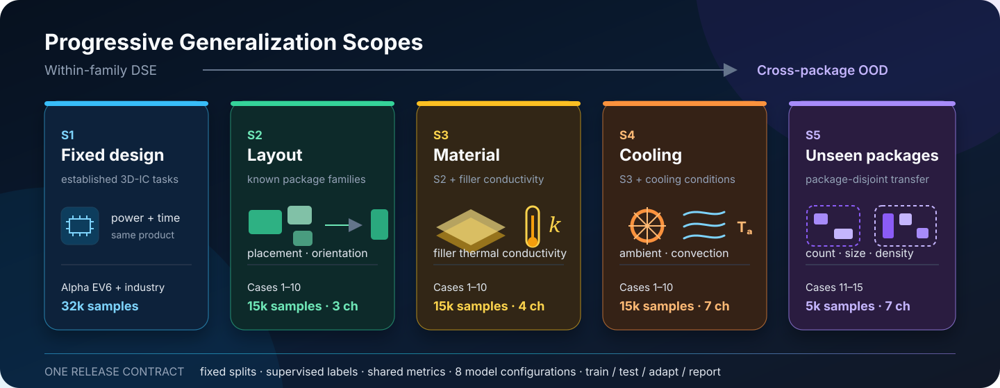
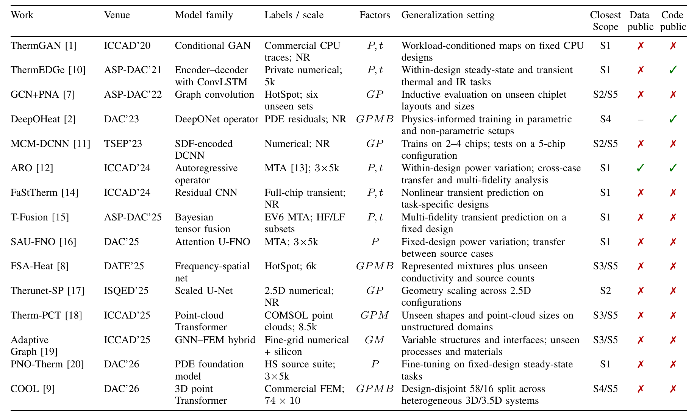
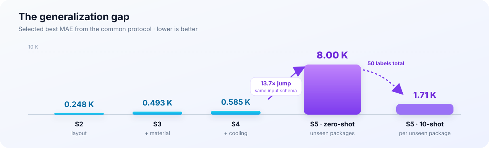

<div align="center">

# OpenTherm

[](README.md)
[](README.zh-CN.md)

A unified and progressive benchmark for 2.5D/3D-IC thermal prediction.

[](https://arxiv.org/abs/2608.23977)
[](https://doi.org/10.5281/zenodo.21992816)
[](LICENSE)
[](LICENSE-DATA)
[](environment.yml)
[](docs/INSTALL.md)
[](https://drive.google.com/file/d/1subkjTHCq-0aMEPBsUiakxYweIMQYG8g/view?usp=sharing)
[](https://drive.google.com/drive/folders/1WzjpOAgeua03F3iLodHlVbTsRhXn1lMA)
[](docs/RESULTS.md)
[](https://drive.google.com/file/d/1dXtFyhiSo68NFZ-HwW6a3gmjdBfaJ_1-/view?usp=sharing)

[**Paper**](https://arxiv.org/abs/2608.23977) · [**Quick start**](#quick-start) · [**Datasets**](docs/DATASETS.md) · [**Results**](docs/RESULTS.md) · [**Reproduce**](docs/REPRODUCE.md) · [**Add a model**](docs/ADD_A_MODEL.md) · [**Paper preview**](docs/PAPER_PREVIEW.md)

</div>



Learning-based thermal predictors are now fast and accurate, but differences in datasets, simulators, and evaluation protocols make published errors hard to compare, and most datasets and implementations remain unavailable. OpenTherm provides a shared basis for comparison. It combines 32,000 established 3D-IC samples with 50,000 new 2.5D chiplet samples generated with the open-source HotSpot simulator, together with fixed data splits, a common input representation, and shared evaluation tools. Five deployment-aligned Generalization Scopes cover fixed-design workload prediction, within-family layout, material, and cooling exploration, and cross-package out-of-distribution (OOD) transfer with few-shot adaptation. Eight model configurations are trained, evaluated, and adapted through one interface.

Developed and maintained by the OpenTherm research team at the **University of Technology Sydney (UTS)**.

> OpenTherm was previously released as **IC-ThermBench** (arXiv v1 and Zenodo v1.0.0). The data, splits, checkpoints, and command-line interface are unchanged.

## Why OpenTherm

Thermal predictors are evaluated with different simulators, physical configurations, spatial resolutions, input representations, splits, and metrics, so published errors are not directly comparable, even for the same predictor. An accurate fixed-design predictor can also face a different distribution when it is deployed in design-space exploration (DSE): designers move chiplets during floorplanning, change filler conductivity during material selection, or vary cooling conditions within a package family, and model reuse on a new product changes chiplet counts, die sizes, and power distributions. OpenTherm evaluates the same predictors across these stages under one protocol.



`G/P/M/B/t` denote geometry or placement, power, material, boundary or cooling, and time; NR means not reported. “Closest Scope” indicates conceptual alignment, not a claim that the datasets or splits are equivalent. Citation indices follow the manuscript bibliography.

## What the benchmark reveals



| Track | Evaluation setting | Best method | MAE ↓ | Second-best method | MAE ↓ |
|---|---|---|---:|---|---:|
| **S1 · Fixed design** | fixed-design source tasks | **Therm-FM** | **0.004–0.049 K**¹ | U-FNO / SAU-FNO (task-dependent) | <u>0.011–0.144 / 0.013–0.162 K</u>² |
| **S2 · Layout** | placement and orientation, Cases 1–10 | **Therm-FM** | **0.248 K** | U-FNO | <u>0.326 K</u> |
| **S3 · Material** | S2 + filler conductivity | **U-FNO** | **0.493 K** | Therm-FM | <u>0.517 K</u> |
| **S4 · Cooling** | S3 + ambient temperature and convection | **Therm-FM** | **0.585 K** | U-FNO | <u>0.724 K</u> |
| **S5 · zero-shot** | five unseen packages, Cases 11–15 | **Therm-FM** | **8.00 K** | U-Net | <u>17.37 K</u> |
| **S5 · 10-shot** | ten labeled fields per unseen package | **Therm-FM** | **1.71 K** | U-Net | <u>1.80 K</u>³ |

¹ S1 contains eleven source tasks, so the paper reports task-group MAE ranges rather than one pooled score. ² The S1 runner-up varies by task between U-FNO and SAU-FNO; their MAE ranges are listed in that order. ³ S5 10-shot results are measured on the fixed 2,500-sample adaptation holdout; S5 zero-shot uses all 5,000 samples. Therm-FM-T/B/L are ranked as one method family, using the best variant on each track. Best results are bold; second-best results are underlined. The [benchmark results](docs/RESULTS.md) add RMSE, per-package results, and the full adaptation curve.

Within known package families, the best MAE rises gradually from 0.248 K on S2 to 0.493 K on S3 and 0.585 K on S4, and seven of the eight configurations stay below 1 K on S4. Zero-shot transfer to unseen packages is qualitatively different: the best MAE reaches 8.00 K, 13.7× the best S4 result, and the smallest Therm-FM variant transfers best even though the largest leads cooling co-design. With ten labeled fields per unseen package, adaptation reduces MAE by 76–93% relative to each model's frozen score on the same holdout. See the [paper preview](docs/PAPER_PREVIEW.md) for interpretation and the [reproduction guide](docs/REPRODUCE.md) for the exact protocol.

## Benchmark at a glance

OpenTherm uses **Scope** rather than “level”: each Scope corresponds to a deployment stage, not a universal maturity rank.

| Scope | Evaluation setting | Active variations | Samples | Target EDA stage |
|---|---|---|---:|---|
| **S1 · Fixed design** | fixed-design prediction (Alpha EV6 + industrial) | power; time for transient tasks | 32,000 | runtime workload analysis |
| **S2 · Layout** | within-family DSE, Cases 1–10 | placement and orientation | 15,000 | floorplan DSE |
| **S3 · Material** | within-family DSE, Cases 1–10 | S2 + filler conductivity | 15,000 | material sweep |
| **S4 · Cooling** | within-family DSE, Cases 1–10 | S3 + ambient temperature, convection, and derived convective resistance | 15,000 | cooling co-design |
| **S5 · Unseen packages** | cross-package OOD, Cases 11–15 | unseen chiplet counts, die sizes, power density and concentration, and utilization | 5,000 | cross-product model reuse |

### Dataset provenance and credit

- **S1 is collected, not regenerated.** OpenTherm preserves the original Alpha EV6 and industrial task definitions, simulators, resolutions, and evaluation conventions used along the [ARO](https://github.com/Mia-WMY/ARO) → [Therm-FM](https://arxiv.org/abs/2605.22663) research line. We do not alter these source tasks or pool their scores with S2–S5. The [S1 source-task datasets](https://drive.google.com/drive/folders/1WzjpOAgeua03F3iLodHlVbTsRhXn1lMA) are now released; the unified one-command evaluator is **on the way**, and the [recorded benchmark results](docs/RESULTS.md) are available now.
- **S2 follows the ATPlace2.5D lineage.** Cases 1–10, their chiplet systems, and the HotSpot-based thermal setup originate from Qipan Wang *et al.*'s [ATPlace2.5D public package](https://github.com/PKU-IDEA/ATPlace_pub). OpenTherm uses this tested foundation for its layout scope.
- **S3–S5 are consistent extensions.** They retain the S2 case and generation conventions while adding filler-conductivity variation, cooling variation, and held-out package architectures. This preserves continuity with an established placement benchmark while expanding the thermal-learning evaluation space.

The current executable release contains the generator-backed **S2–S5** data and code path. The S1 datasets are released separately and kept distinct from S2–S5; a unified S1 evaluator is on the way.

### Eight configurations, one protocol

| Model family | Configurations |
|---|---|
| Convolutional network | U-Net |
| Fourier neural operators | FNO, U-FNO, SAU-FNO |
| DeepONet-based operator | DeepOHeat |
| Pretrained PDE foundation models | Therm-FM-T / B / L |

Every configuration receives the same labeled samples, split membership, physical channels, and metric implementation. The release does not force one optimizer onto every architecture: model-specific training recipes are preserved in [`MODEL_ZOO`](exp/exp_basic.py).

For DeepOHeat, we report fully supervised training rather than its label-free physics-residual scheme so that it is compared fairly with the other supervised baselines. In our tests, the supervised variant was also substantially more accurate and more stable to train.

## Quick start

### 1. Install

```bash
git clone https://github.com/Day333/OpenTherm.git
cd OpenTherm
conda env create -f environment.yml
conda activate opentherm
python script/smoke_test.py
```

The frozen environment matches the benchmark checkpoints. Therm-FM is version-sensitive; read the [installation notes](docs/INSTALL.md) before changing PyTorch, Transformers, or Accelerate.

### 2. Place data and checkpoints

Download the [datasets (~4.8 GB unpacked)](https://drive.google.com/file/d/1subkjTHCq-0aMEPBsUiakxYweIMQYG8g/view?usp=sharing) and the [S2–S5 checkpoints (~27.5 GB)](https://drive.google.com/file/d/1dXtFyhiSo68NFZ-HwW6a3gmjdBfaJ_1-/view?usp=sharing), and unpack both at the repository root; the checkpoint archive unpacks into `checkpoints/` and `results/`:

```text
OpenTherm/
├── datasets/
│   ├── level2_steady/
│   ├── level3_steady/
│   ├── level4_steady/
│   └── level5_steady/
├── checkpoints/
└── results/
```

The public command tokens remain `level2`–`level5` for checkpoint compatibility; they correspond to paper Scopes S2–S5.

### 3. Evaluate

```bash
# One baseline on one scope
python run.py --model UFNO --data level2 --task test

# Frozen S4 checkpoint on cross-package OOD S5
python run.py --model ThermFM-T --data level5 --task test

# All 8 evaluated configurations × S2–S5, followed by one summary table
bash script/test_all.sh
```

When `--load` is omitted, S5 zero-shot evaluation automatically resolves the matching S4 checkpoint. No S5 labels or normalization updates are used.

## Train, adapt, compare

```bash
# Train one model on S2/S3/S4
bash script/UFNO/train.sh

# Ten labeled samples per unseen S5 package
python run.py --model UFNO --data level5 --task finetune --shots 10

# Run all released adaptation recipes
bash script/finetune_all.sh

# Rebuild the benchmark summary from saved metrics
python utils/summarize.py level2 level3 level4 level5
```

`run.py` is the single entry point; every command also accepts `--root_path`, `--checkpoints`, `--load`, and `--output`. Full commands, split semantics, metric definitions, and reproducibility boundaries are in [docs/REPRODUCE.md](docs/REPRODUCE.md).

## Use OpenTherm for your model

A new predictor only needs to satisfy one tensor contract:

```text
input   (B, Y, X, Z, P)
output  (B, Y, X, Z)       where X = Y = 64 and Z = 1
```

Register the constructor and training recipe once, then the existing scripts provide matched S2–S5 training, zero-shot evaluation, few-shot adaptation, and the shared metrics. The complete three-step example is in [docs/ADD_A_MODEL.md](docs/ADD_A_MODEL.md).

## Reproducibility contract

- **Data:** published tensors, physical-channel schema, and S5 case manifest.
- **Splits:** deterministic, index-based train/validation/test membership.
- **Labels:** supervised reference-temperature fields for every baseline.
- **Metrics:** one implementation for RMSE, MAE, R², MaxAE, peak-temperature error, and Top-50 MAE.
- **Recipes:** architecture-specific optimization is recorded, not retroactively homogenized.
- **Artifacts:** JSON outputs and the released checkpoints can be audited without retraining.

The release is designed to be easy to reproduce **and** easy to extend: data conversion, model execution, evaluation, aggregation, and OOD adaptation all use the same repository-level interface.

## Documentation

| Guide | Contents |
|---|---|
| [Installation](docs/INSTALL.md) | exact environment, GPU notes, Therm-FM dependencies |
| [Datasets](docs/DATASETS.md) | files, shapes, channels, splits, manifests, checkpoints |
| [Benchmark results](docs/RESULTS.md) | S1 source tasks, S2–S4 within-family results, S5 zero-shot and adaptation |
| [Reproduce](docs/REPRODUCE.md) | evaluation tracks, commands, metrics, expected key results |
| [Add a model](docs/ADD_A_MODEL.md) | tensor contract, registry entry, scripts, integration checklist |
| [Paper preview](docs/PAPER_PREVIEW.md) | benchmark motivation, design, findings, and paper status |

## Current limitations

- S1 datasets are released; a unified one-command evaluation script is still in progress, and its stored values currently preserve source-reported protocols.
- S2–S5 currently cover 64×64 steady-state fields with `Z=1`; progressive transient evaluation beyond S1 remains future work.
- S2–S4 are independently generated, not sample-wise paired, so their differences measure distributional difficulty rather than a strict causal ablation.
- S5 contains five held-out packages. It reveals a substantial cross-package OOD gap, but cannot represent every industrial package, process, or cooling technology; coverage of commercial-grade packages remains a priority for future expansion.
- The benchmark is label-supervised. Physics-only and label-free training answer a different question and are not presented as directly interchangeable baselines.

## Citation

If you use OpenTherm, please cite the paper.

```bibtex
@article{opentherm2026,
  title   = {OpenTherm: A Unified and Progressive Benchmark for 2.5D/3D-IC
             Thermal Prediction},
  author  = {David Hang and Wenkai Yang and Kuiye Ding and Haiyang Xin and Jacky Wei},
  journal = {arXiv preprint arXiv:2608.23977},
  year    = {2026},
  url     = {https://arxiv.org/abs/2608.23977}
}
```

## License and acknowledgements

- Repository code is released under the [MIT License](LICENSE).
- Original OpenTherm S2–S5 data, fixed splits, and released result records are available under [CC BY 4.0](LICENSE-DATA): reuse and extension are welcome with attribution.
- S1 source data and third-party components retain their original licenses. The OpenTherm manuscript and paper-derived prose, figures, and tables are not relicensed as dataset content.

See the [license map and attribution guidance](LICENSES.md) for the exact boundaries. Open licensing permits legitimate reuse; it does not permit claiming the benchmark, paper text, or curation work as someone else's contribution.

We thank the authors of [ARO](https://github.com/Mia-WMY/ARO), [Therm-FM](https://arxiv.org/abs/2605.22663), and [ATPlace2.5D](https://github.com/PKU-IDEA/ATPlace_pub), as well as the HotSpot, Poseidon/scOT, FNO, U-FNO, and DeepOHeat communities. Their public artifacts and source tasks make a shared thermal-learning benchmark possible.
