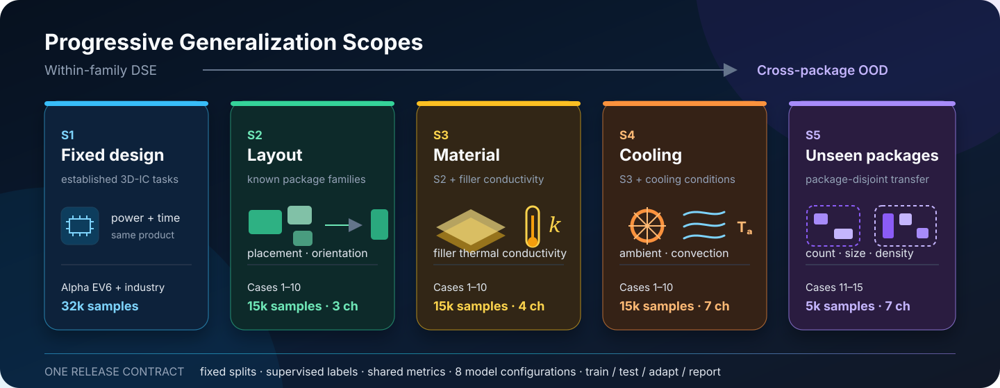
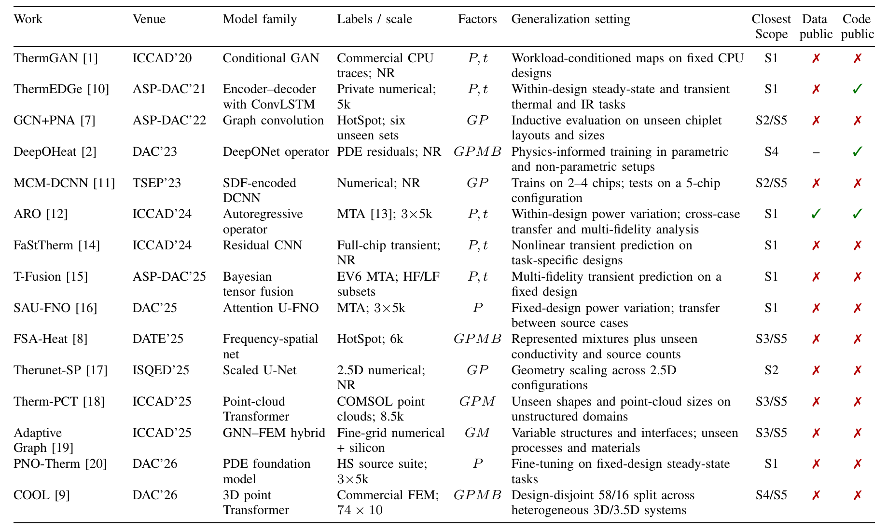
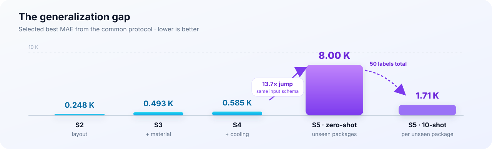

<div align="center">

# OpenTherm

[](README.md)
[](README.zh-CN.md)

面向 2.5D/3D-IC 热预测的统一、渐进式基准。

[](https://arxiv.org/abs/2608.23977)
[](https://doi.org/10.5281/zenodo.21992816)
[](LICENSE)
[](LICENSE-DATA)
[](environment.yml)
[](docs/INSTALL.md)
[](https://drive.google.com/file/d/1subkjTHCq-0aMEPBsUiakxYweIMQYG8g/view?usp=sharing)
[](https://drive.google.com/drive/folders/1WzjpOAgeua03F3iLodHlVbTsRhXn1lMA)
[](docs/RESULTS.md)
[](https://drive.google.com/file/d/1dXtFyhiSo68NFZ-HwW6a3gmjdBfaJ_1-/view?usp=sharing)

[**论文**](https://arxiv.org/abs/2608.23977) · [**快速开始**](#快速开始) · [**数据集**](docs/DATASETS.md) · [**实验结果**](docs/RESULTS.md) · [**复现实验**](docs/REPRODUCE.md) · [**接入新模型**](docs/ADD_A_MODEL.md) · [**论文预览**](docs/PAPER_PREVIEW.md)

</div>



基于学习的热预测模型已经兼具较高精度与较低计算成本，但数据集、仿真器和评测协议的差异使已发表的误差难以直接比较，多数数据集和实现也没有公开。**OpenTherm 提供统一的比较基础**：它将 32,000 个已有的 3D-IC 样本与 50,000 个使用开源 HotSpot 仿真器新生成的 2.5D 芯粒样本结合，并提供固定的数据划分、统一的输入表示和共享的评测工具。五个面向实际部署的 Generalization Scope 覆盖固定设计下的工作负载预测、封装家族内的布局、材料与散热探索，以及带少样本适配的跨封装分布外（OOD）迁移。八套模型配置通过同一接口完成训练、评测与适配。

本项目由 **悉尼科技大学（University of Technology Sydney, UTS）** OpenTherm 研究团队开发和维护。

> OpenTherm 的早期版本（arXiv v1 与 Zenodo v1.0.0）曾以 **IC-ThermBench** 为名发布；数据、划分、checkpoint 和命令行接口均保持不变。

## 为什么需要 OpenTherm

不同研究使用的仿真器、物理配置、空间分辨率、输入表示、数据划分和指标各不相同，因此即使是同一个预测模型，已发表的误差也无法直接比较。一个在固定设计上很准确的模型，在设计空间探索（DSE）中也会面对不同的分布：设计者会在布图规划时移动芯粒、在选材时改变填充材料热导率，或在同一封装家族内改变散热条件；而把模型复用到新产品时，芯粒数量、裸片尺寸和功率分布都会改变。OpenTherm 用同一套协议评测模型在这些阶段的表现。



图中 `G/P/M/B/t` 分别表示几何或布局、功率、材料、边界或散热条件以及时间；NR 表示未报告。“Closest Scope”仅表示概念上的对应关系，并不表示不同数据集或划分方式完全等价。文献编号与论文参考文献一致。

## 核心结果



| 评测轨道 | 评测设置 | 最佳方法 | MAE ↓ | 次佳方法 | MAE ↓ |
|---|---|---|---:|---|---:|
| **S1 · 固定设计** | 固定设计的来源任务 | **Therm-FM** | **0.004–0.049 K**¹ | U-FNO / SAU-FNO（随任务变化） | <u>0.011–0.144 / 0.013–0.162 K</u>² |
| **S2 · 布局** | Cases 1–10 的位置与方向变化 | **Therm-FM** | **0.248 K** | U-FNO | <u>0.326 K</u> |
| **S3 · 材料** | S2 + 填充材料热导率 | **U-FNO** | **0.493 K** | Therm-FM | <u>0.517 K</u> |
| **S4 · 散热** | S3 + 环境温度与对流系数 | **Therm-FM** | **0.585 K** | U-FNO | <u>0.724 K</u> |
| **S5 · zero-shot** | 五个未见封装（Cases 11–15） | **Therm-FM** | **8.00 K** | U-Net | <u>17.37 K</u> |
| **S5 · 10-shot** | 每个未见封装使用十个标注样本 | **Therm-FM** | **1.71 K** | U-Net | <u>1.80 K</u>³ |

¹ S1 包含十一个来源任务，因此论文给出各任务组的 MAE 范围，而不是混合后的单一分数。² S1 的次佳方法随任务在 U-FNO 与 SAU-FNO 之间变化，两者的 MAE 范围按此顺序列出。³ S5 10-shot 结果在固定的 2,500 样本适配测试集上计算，S5 zero-shot 使用全部 5,000 个样本。排名时将 Therm-FM-T/B/L 视为同一个模型家族，并在每条轨道取其中最优的结果。最佳结果以粗体表示，次佳结果以下划线表示。[实验结果](docs/RESULTS.md)中另有 RMSE、逐封装结果和完整适配曲线。

在已知封装家族内，最佳 MAE 从 S2 的 0.248 K 逐步升至 S3 的 0.493 K 和 S4 的 0.585 K，八套配置中有七套在 S4 上的 MAE 仍低于 1 K。迁移到未见封装时情况明显不同：zero-shot 最佳 MAE 达到 8.00 K，是 S4 最佳结果的 13.7 倍；而且迁移效果最好的是最小的 Therm-FM 变体，最大的变体只在散热协同设计（S4）上领先。每个未见封装只用十个标注样本进行适配，MAE 相对各模型在同一测试集上的冻结结果下降 76–93%。解读见[论文预览](docs/PAPER_PREVIEW.md)，具体协议见[复现实验说明](docs/REPRODUCE.md)。

## Benchmark 概览

OpenTherm 使用 **Scope** 而不是 “level”：每个 Scope 对应一个部署阶段，而不是模型成熟度的统一等级。

| Scope | 评测设置 | 可变因素 | 样本数 | 对应 EDA 阶段 |
|---|---|---|---:|---|
| **S1 · 固定设计** | 固定设计预测（Alpha EV6 + 工业案例） | 功率；瞬态任务中的时间 | 32,000 | 运行时工作负载分析 |
| **S2 · 布局** | 封装家族内 DSE，Cases 1–10 | 位置与方向 | 15,000 | 布图规划 DSE |
| **S3 · 材料** | 封装家族内 DSE，Cases 1–10 | S2 + 填充材料热导率 | 15,000 | 材料扫描 |
| **S4 · 散热** | 封装家族内 DSE，Cases 1–10 | S3 + 环境温度、对流系数及由此导出的对流热阻 | 15,000 | 散热协同设计 |
| **S5 · 未见封装** | 跨封装 OOD，Cases 11–15 | 未见的芯粒数量、裸片尺寸、功率密度与集中度、硅面积利用率 | 5,000 | 跨产品模型复用 |

### 数据来源与致谢

- **S1 是对已有公开任务的整理，而非重新生成。** 我们保留 [ARO](https://github.com/Mia-WMY/ARO) → [Therm-FM](https://arxiv.org/abs/2605.22663) 路线中 Alpha EV6 与工业案例原有的任务定义、仿真器、分辨率和评测方式。S1 数据集现已[发布](https://drive.google.com/drive/folders/1WzjpOAgeua03F3iLodHlVbTsRhXn1lMA)；统一的一键评测代码仍在准备中，现有结果已记录在[实验结果](docs/RESULTS.md)中。
- **S2 延续 ATPlace2.5D 数据路线。** Cases 1–10、芯粒系统及基于 HotSpot 的热设置来源于 Qipan Wang 等人的 [ATPlace2.5D 开源项目](https://github.com/PKU-IDEA/ATPlace_pub)。
- **S3–S5 是保持生成规范一致的扩展。** 它们在 S2 基础上依次加入填充材料热导率变化、散热条件变化和未见封装架构，从而兼顾数据连续性、广度与新颖性。

当前可执行版本包含由生成器支持的 **S2–S5** 数据及完整代码路径。S1 数据集已单独发布并与 S2–S5 保持独立，统一的 S1 评测入口仍在准备中。

### 八套配置，一套协议

| 模型类别 | 配置 |
|---|---|
| 卷积神经网络 | U-Net |
| Fourier 神经算子 | FNO、U-FNO、SAU-FNO |
| 基于 DeepONet 的算子 | DeepOHeat |
| 预训练 PDE 基础模型 | Therm-FM-T / B / L |

所有配置使用相同的标签样本、数据划分、物理输入通道和指标实现；同时保留各模型自己的优化配方，具体配置见 [`MODEL_ZOO`](exp/exp_basic.py)。

对于 DeepOHeat，我们报告使用标签的全监督训练结果，而不是无标签物理残差训练，以保证与其他全监督 baseline 的公平比较。在我们的测试中，全监督版本的精度也显著更高，训练更加稳定。

## 快速开始

### 1. 安装

```bash
git clone https://github.com/Day333/OpenTherm.git
cd OpenTherm
conda env create -f environment.yml
conda activate opentherm
python script/smoke_test.py
```

冻结环境与基准 checkpoint 保持一致。Therm-FM 对版本较敏感，修改 PyTorch、Transformers 或 Accelerate 前请阅读[安装说明](docs/INSTALL.md)。

### 2. 放置数据和模型权重

下载[数据集（解压后约 4.8 GB）](https://drive.google.com/file/d/1subkjTHCq-0aMEPBsUiakxYweIMQYG8g/view?usp=sharing)和 [S2–S5 模型权重（约 27.5 GB）](https://drive.google.com/file/d/1dXtFyhiSo68NFZ-HwW6a3gmjdBfaJ_1-/view?usp=sharing)，均解压至仓库根目录；权重压缩包会解压出 `checkpoints/` 与 `results/`：

```text
OpenTherm/
├── datasets/
│   ├── level2_steady/
│   ├── level3_steady/
│   ├── level4_steady/
│   └── level5_steady/
├── checkpoints/
└── results/
```

为保持 checkpoint 兼容性，命令行参数仍使用 `level2`–`level5`，分别对应论文中的 S2–S5。

### 3. 评测

```bash
# 在一个 Scope 上评测一个 baseline
python run.py --model UFNO --data level2 --task test

# 使用冻结的 S4 checkpoint 进行 S5 跨封装 OOD 测试
python run.py --model ThermFM-T --data level5 --task test

# 评测 8 套配置 × S2–S5，并生成汇总表
bash script/test_all.sh
```

当未指定 `--load` 时，S5 zero-shot 评测会自动加载对应的 S4 checkpoint，不使用 S5 标签，也不会更新归一化统计量。

## 训练、适配与比较

```bash
# 在 S2/S3/S4 上训练一个模型
bash script/UFNO/train.sh

# 每个未见 S5 封装使用十个标注样本进行适配
python run.py --model UFNO --data level5 --task finetune --shots 10

# 执行所有已发布的少样本适配配置
bash script/finetune_all.sh

# 根据保存的指标重新生成汇总结果
python utils/summarize.py level2 level3 level4 level5
```

`run.py` 是统一入口。完整命令、数据划分语义、指标定义和复现边界见[复现实验说明](docs/REPRODUCE.md)。

## 接入你的模型

新模型只需满足统一张量接口：

```text
input   (B, Y, X, Z, P)
output  (B, Y, X, Z)       其中 X = Y = 64，Z = 1
```

注册模型构造函数与训练配方后，现有脚本即可提供一致的 S2–S5 训练、zero-shot 评测、few-shot 适配与指标计算。完整示例见[接入新模型](docs/ADD_A_MODEL.md)。

## 可复现性约定

- **数据：** 已发布张量、物理通道定义及 S5 案例清单。
- **划分：** 确定且基于索引的训练集、验证集和测试集。
- **标签：** 所有 baseline 均使用参考温度场监督。
- **指标：** 统一实现 RMSE、MAE、R²、MaxAE、最高温度误差和 Top-50 MAE。
- **训练配方：** 记录各架构自己的优化设置，而不是强行使用相同优化器。
- **产物：** 可直接检查 JSON 输出和已发布的 checkpoint，无需重新训练。

## 文档

详细技术文档目前保持英文，以避免不同语言版本出现协议偏差：

| 文档 | 内容 |
|---|---|
| [安装说明](docs/INSTALL.md) | 环境、GPU 配置及 Therm-FM 依赖 |
| [数据集](docs/DATASETS.md) | 文件、形状、通道、划分、清单和 checkpoint |
| [实验结果](docs/RESULTS.md) | S1 来源任务、S2–S4 封装家族内结果、S5 zero-shot 与适配 |
| [复现实验](docs/REPRODUCE.md) | 评测轨道、命令、指标及关键预期结果 |
| [接入新模型](docs/ADD_A_MODEL.md) | 张量接口、模型注册、脚本和集成检查清单 |
| [论文预览](docs/PAPER_PREVIEW.md) | Benchmark 动机、设计、发现与论文状态 |

## 当前局限

- S1 数据集已发布；统一的一键评测脚本仍在准备中，当前保存值沿用来源论文的评测协议。
- S2–S5 目前覆盖 `Z=1` 的 64×64 稳态温度场；S1 以外的渐进式瞬态评测仍属于未来工作。
- S2–S4 独立生成，并非逐样本配对，因此 Scope 间差异表示分布难度，而非严格的因果消融。
- S5 包含五个未见封装，能够揭示跨封装 OOD 差距，但无法覆盖所有工业封装、工艺或散热技术；纳入商用级封装是后续扩展的重点。
- 本基准使用标签监督；仅物理约束或无标签训练回答的是不同问题，不应直接混为同一类 baseline。

## 引用

如果 OpenTherm 对你的工作有帮助，请引用论文。

```bibtex
@article{opentherm2026,
  title   = {OpenTherm: A Unified and Progressive Benchmark for 2.5D/3D-IC
             Thermal Prediction},
  author  = {David Hang and Wenkai Yang and Kuiye Ding and Haiyang Xin and Jacky Wei},
  journal = {arXiv preprint arXiv:2608.23977},
  year    = {2026},
  url     = {https://arxiv.org/abs/2608.23977}
}
```

## 许可证与致谢

- 仓库代码使用 [MIT License](LICENSE)。
- 原创 OpenTherm S2–S5 数据、固定划分及发布结果采用 [CC BY 4.0](LICENSE-DATA)，欢迎在注明来源的前提下使用和扩展。
- S1 来源数据与第三方组件沿用各自原始许可证；论文及来自论文的文字、图片和表格不作为数据内容重新授权。

具体边界与署名方式见[许可证说明](LICENSES.md)。开放许可允许合理使用，但不允许将本 benchmark、论文文字或数据整理工作冒充为他人的贡献。

感谢 [ARO](https://github.com/Mia-WMY/ARO)、[Therm-FM](https://arxiv.org/abs/2605.22663) 和 [ATPlace2.5D](https://github.com/PKU-IDEA/ATPlace_pub) 的作者，以及 HotSpot、Poseidon/scOT、FNO、U-FNO 与 DeepOHeat 社区。正是这些公开产物和来源任务，使统一热学习 benchmark 成为可能。
