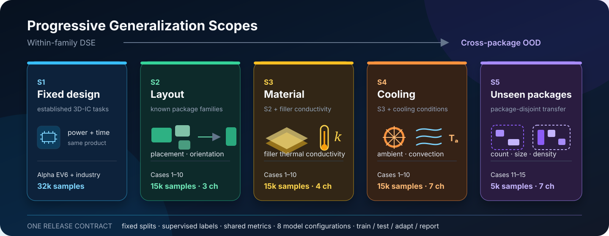
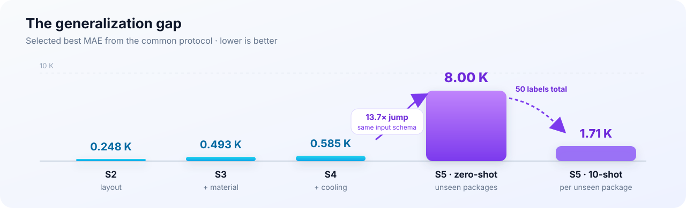

# OpenTherm paper preview

> **Status:** the paper is available on arXiv: [arXiv:2608.23977](https://arxiv.org/abs/2608.23977). Version 1 of the paper and repository used the earlier name IC-ThermBench. This page summarizes the benchmark's central design and selected results; the paper itself is the reference for the full protocol, tables, and discussion.

## Motivation

Accurate and efficient chip thermal prediction is essential for advanced packaging design, and deep learning-based thermal predictors now achieve high accuracy at a fraction of the cost of repeated simulation. However, differences in datasets, simulators, and evaluation protocols hinder direct comparison of existing methods and systematic assessment of how they generalize across design variations and cross-package transfer scenarios. A result can improve because the task changed—not because the predictor is better.

OpenTherm addresses this evaluation gap rather than proposing another thermal model. Its contributions are:

- **an open, progressive generalization benchmark** that jointly covers fixed-design prediction, within-family design exploration, and package-disjoint transfer through five evaluation scopes, with controlled target-label budgets for adaptation;
- **an extensible suite for training and fair comparison** that combines 32,000 established 3D-IC samples with 50,000 newly generated HotSpot-based 2.5D chiplet samples, supported by a parametric generator, fixed splits, and shared model and evaluation interfaces; and
- **a systematic study of thermal generalization** across eight model configurations using shared inputs, labels, splits, and metrics within each task.

The release also bundles the practical path around the benchmark: data formatting, model execution, training, inference, adaptation, aggregation, and result export share one interface.

## Why “Scope”

The five Generalization Scopes are aligned with three deployment regimes—fixed-design workload prediction, within-family design-space exploration, and cross-package model reuse. They are not a leaderboard rank that every application must maximize:

| Scope | Systems | Active variations | Target EDA stage |
|---|---|---|---|
| S1 · Fixed design | Alpha EV6 + industrial | power; time for transient tasks | runtime workload |
| S2 · Layout | Cases 1–10 | placement and orientation | floorplan DSE |
| S3 · Material | Cases 1–10 | S2 + filler conductivity | material sweep |
| S4 · Cooling | Cases 1–10 | S3 + ambient temperature, convection, and convective resistance | cooling co-design |
| S5 · Unseen packages | Cases 11–15 | cross-package OOD | cross-product reuse |

This progression lets a practitioner choose the smallest sufficient contract instead of treating all forms of “generalization” as interchangeable.

## Dataset design

S1 consolidates eleven established fixed-design thermal-learning tasks spanning steady-state and transient Alpha EV6 configurations and two industrial packages. It contains 32,000 samples and preserves the source task definitions and fidelity settings from the [ARO](https://github.com/Mia-WMY/ARO) and [Therm-FM](https://arxiv.org/abs/2605.22663) lineage; its [recorded results](RESULTS.md) remain task-specific.

S2–S4 contain 45,000 steady-state samples from ten package families (Cases 1–10) adapted from Qipan Wang *et al.*'s [ATPlace2.5D public cases and thermal setup](https://github.com/PKU-IDEA/ATPlace_pub). Each family fixes the interposer footprint, layer-stack template, and chiplet inventory; the families contain 6–61 chiplets on interposers from 26×23 to 59×61 mm². Each scope contains 15,000 independently sampled layouts and physical settings, with input channels expanding from 3 (S2) to 4 (S3) and 7 (S4).

S5 retains the 7-channel S4 schema on 1,000 samples from each of five packages held out from source training and validation. Each package combines multiple structural and thermal changes: Case 11 has 80 chiplets; Case 12 reaches 0.85 W/mm² package power density (training maximum 0.745 W/mm²); Case 13 combines one 42×16 mm² die with 24 micro-chiplets; Case 14 concentrates 90.9% of package power in one chiplet (training maximum 69.2%); and Case 15 reaches 68.1% silicon utilization (training maximum 67.1%).

All 50,000 S2–S5 samples are generated with HotSpot in detailed-3D steady-state grid mode on a six-layer stack, and the target is the 64×64 steady-state temperature map of the chiplet layer, in kelvin.

## Key findings

All reported Therm-FM results use the released single-GPU configuration: AdamW with training learning rate `1.5e-4`, embedding/recovery learning rate `1.5e-3`, batch size 40, and validation-best checkpoint selection. Values below are MAE in kelvin unless stated otherwise.

### Fixed-design anchor

On S1, FNO, U-FNO, and SAU-FNO achieve MAEs below 0.17 K on all reported tasks, and the source-study results for Therm-FM-L span 0.004–0.049 K. S1 therefore anchors what is attainable when the physical design remains fixed; it is not pooled with the controlled S2–S5 comparison.

### Finding 1 — low absolute errors remain attainable within package families

The best MAE increases from 0.248 K on S2 to 0.493 K on S3 and 0.585 K on S4. Even with joint variation in layout, materials, and cooling, seven of the eight configurations retain MAE below 1 K on S4. Rankings depend on the scope and the metric: Therm-FM-L leads S2 and S4, U-FNO leads S3, and U-FNO stays within 1.26× of the best RMSE on every within-family scope with about 5.1M parameters.

### Finding 2 — cross-package generalization is a much greater challenge

On the full S5 test set, the best MAE reaches 8.003 K, 13.7× the S4 minimum. Larger models do not consistently generalize better: the largest Therm-FM variant leads cooling co-design, whereas the smallest performs best in frozen cross-package transfer. Per-package rankings also differ—Therm-FM-T leads Cases 14 and 15, Therm-FM-B leads Cases 11 and 13, and U-Net leads Case 12.

### Finding 3 — limited target supervision can substantially mitigate the gap

With ten labeled fields per unseen package (50 in total), adaptation reduces MAE by 76–93% relative to each model's frozen baseline on the same holdout, with Therm-FM-T reaching 1.71 K. At K=50, Therm-FM-T and Therm-FM-L are within 0.03 K of U-Net's best MAE of 1.01 K, and at K=500, U-FNO reaches 0.59 K. Within-family accuracy, zero-shot transfer, and adaptation should therefore be evaluated separately.

## What is public now

- the [complete S1–S5 benchmark result record](RESULTS.md), with the S1 datasets released and the unified S1 evaluator on the way;
- S2–S5 data tensors and the S5 case manifest;
- [S2–S5 baseline checkpoints](https://drive.google.com/file/d/1dXtFyhiSo68NFZ-HwW6a3gmjdBfaJ_1-/view?usp=sharing), including the S5 few-shot adapted models;
- eight baseline configurations across convolutional, Fourier-operator, DeepONet-based, and pretrained PDE-foundation-model families;
- zero-shot and few-shot execution paths;
- one shared metric implementation and summary command; and
- a citable Zenodo software release.

The arXiv manuscript contains the full related-work comparison, complete baseline tables, per-package S5 analysis, and formal citation.
